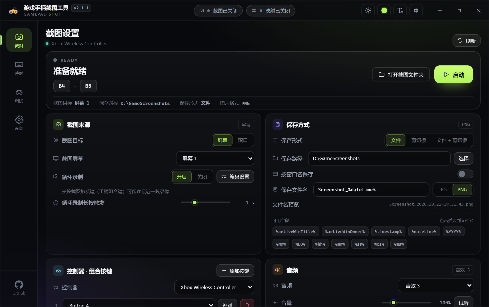
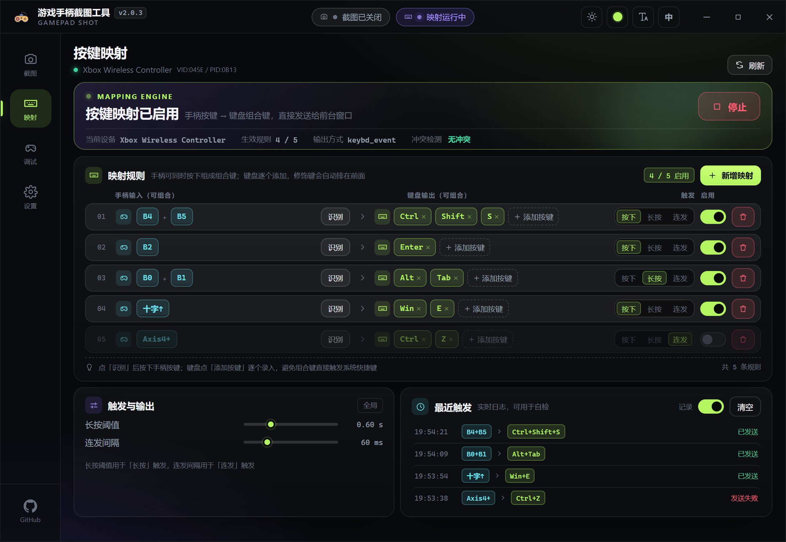
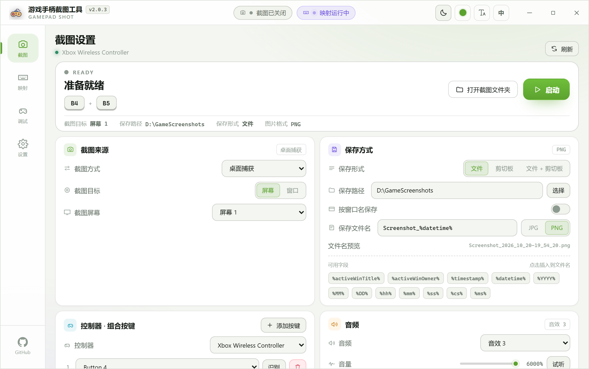
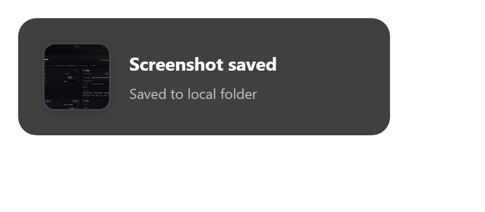
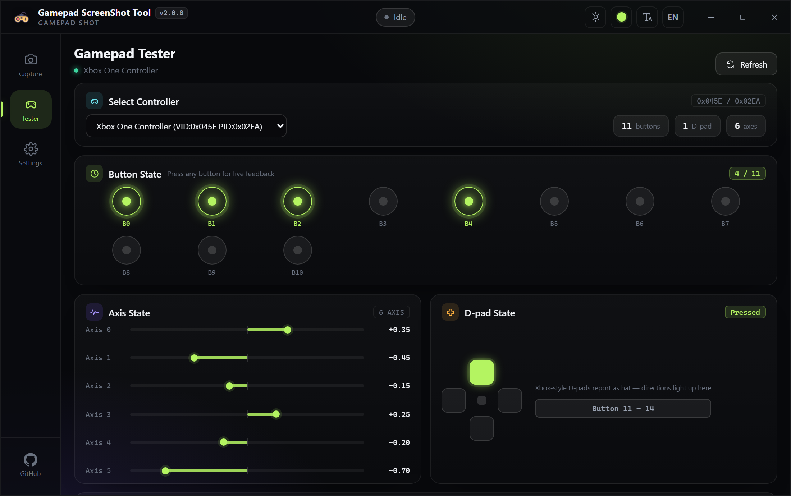
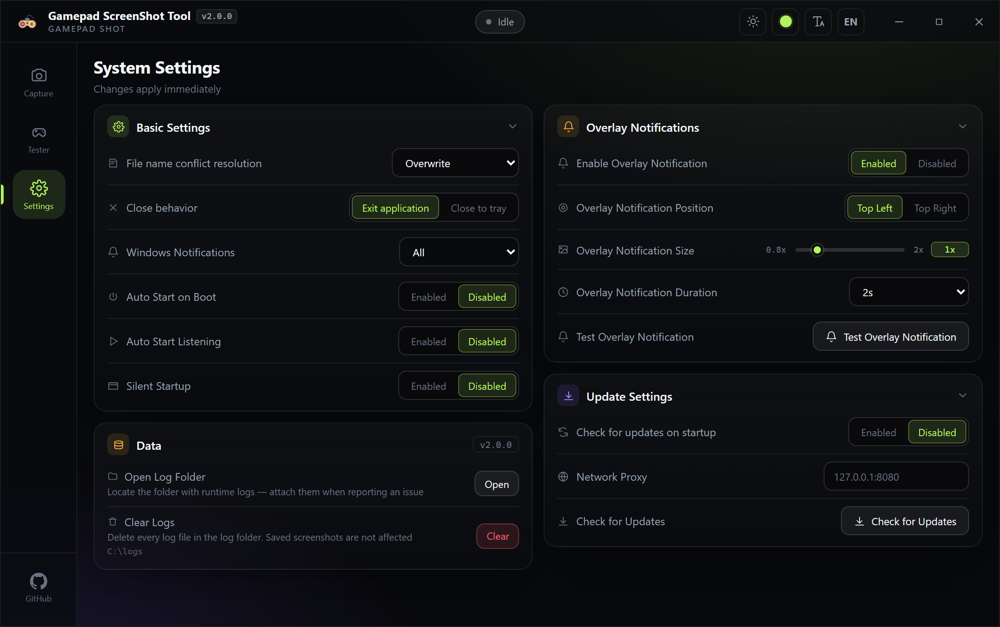
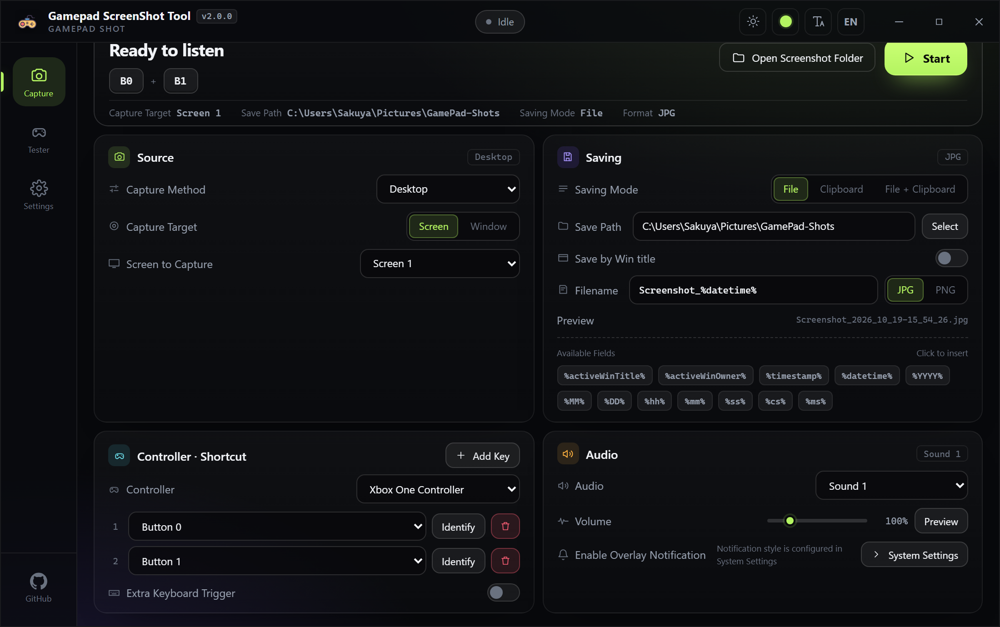

# 🎮 GamePad-ScreenShot

  <a href="README.md">简体中文</a> | <a href="readme/README_ZH-TW.md">繁體中文</a> | <a href="readme/README_EN.md">English</a> | <a href="readme/README_JA.md">日本語</a> | <a href="readme/README_KO.md">한국어</a> | <a href="readme/README_DE.md">Deutsch</a> | <a href="readme/README_FR.md">Français</a> | <a href="readme/README_ES.md">Español</a> | <a href="readme/README_RU.md">Русский</a>

  

  <strong>使用手柄快捷键进行全屏截图、窗口截图，并循环录制最近画面的工具</strong>

  
  
  

---

## 📖 简介

一款 Windows 小工具，让你用手柄的**按键组合**或**轴值**来触发截图，而不必去碰键盘——非常适合那些会独占鼠标、或以全屏运行的游戏。截图可以保存到硬盘或剪贴板；内置的**循环录制**引擎还能一直留住最近一段画面，**长按**组合键就把刚才的高光存成 MP4，不需要安装 OBS。另外还支持把手柄按键**映射成键盘按键或组合键**，把手柄当成快捷键面板来用。

- ✅ 组合键 / 轴值（十字键、L2 / R2 等）触发
- ✅ 额外支持键盘热键触发
- ✅ 全屏截图（可选择特定显示器）或单窗口截图
- ✅ 保存到文件 / 剪贴板 / 两者皆可 —— 支持 JPG / PNG
- ✅ 自定义文件名模板：`%activeWinTitle%`、`%timestamp%`、`%datetime%` ……
- ✅ 文件名冲突处理：覆盖 / 追加时间戳 / 跳过 / 每次询问
- ✅ 截图音效 —— 5 种内置音效，可调节音量
- ✅ 覆层通知，位置、时长、尺寸均可配置
- ✅ **循环录制** —— 长按组合键保存最近 N 秒，内置 FFmpeg 引擎（NVENC / QSV / AMF / x264），无需安装 OBS
- ✅ 长按触发秒数可调，保存后浮窗带片段缩略图
- ✅ 内置手柄测试器 —— 按键、轴、十字键实时点亮
- ✅ 9 种界面语言，深色 / 浅色主题，6 种主题色
- ✅ **手柄按键 → 键盘按键** —— 单键或组合键触发任意键盘按键 / 组合键，支持 Win 键、多媒体键
- ✅ 三种触发方式：按下 / 长按 / 连发，阈值与间隔可调，每条规则可单独启停
- ✅ 键盘按键逐个录入，录制组合键时不会误触系统快捷键
- ✅ 开机自启、静默启动、最小化到托盘、启动时运行截图监听 / 键盘映射
- ✅ 应用内更新

---

## 🖼️ 软件界面

### 主界面

  

### 按键映射

  

### 浅色主题

  

### 覆层通知

  

### 手柄测试器

  

### 系统设置

  

---

## 🎮 如何设置组合按键

> **说明：** 轴值（十字键方向、L2 / R2 扳机……）同样可以作为触发。轴值需在 **±0.85** 以上才视为“按下”。

1. 在 **控制器 · 组合键** 卡片中添加按键。你可以到内置的 **手柄测试** 页面去核对每个条目对应哪个实体按键——按下按键时它会实时点亮。

  

> **提示：** 部分手柄在蓝牙下会报告不同的按键索引——配置组合键时建议优先使用 **USB** 连接。

---

## ⌨️ 手柄按键映射键盘

适合切歌、开麦、快捷栏这类只能用键盘完成的操作——现在用手柄就能触发。

1. 打开左侧 **映射** 页，点右上角 **启动**；想让它开机就跑，到 **设置 → 启动时运行键盘映射** 打开。
2. 点 **新增映射**，在手柄输入一侧点 **识别**，然后按下手柄按键——同时按住多个就是组合键。
3. 在键盘输出一侧点 **+ 添加按键**，一个键一个键地按（先加 Ctrl / Shift / Alt / Win 这类修饰键）。点键帽上的 × 可以删掉某个键。
4. 每行右侧选择触发方式：**按下** / **长按**（阈值在下方「长按阈值」里调）/ **连发**（间隔在「连发间隔」里调）。
5. 打开「最近触发」的 **记录** 开关，就能实时看到哪条规则命中了。

> **说明：** 映射只负责“发键盘”，不会拦截手柄的原始输入——游戏仍然会收到手柄按键；真要屏蔽需要虚拟手柄驱动（如 ViGEm / HidHide）。

---

## 🔁 循环录制最近画面

录像不是「开录 → 停止」那套，而是**一直留住最近的画面**：开始监听后引擎就在后台采集编码，数据只放在内存里，长按才落盘。

1. 打开 **截图设置** 页面，在「截图来源」里把 **循环录制** 切到 **开启**。
2. 直接在下面选 **长按触发** 的秒数（0.5 / 0.8 / 1 / 1.5 / 2 / 3 秒）——按住组合键到设定时长就会保存，松手早了还是照常截图。
3. 点 **设置** 可以细调：编码引擎（NVENC / QSV / AMF / x264）、输出分辨率、帧率、画质或码率、缓冲时长（保存时往前取多少秒）、最大内存。
4. 拿不准会不会掉帧时点 **测试编码性能**：端到端跑一遍采集 + 编码，直接告诉你丢了几帧、还剩多少余量。
5. 保存下来的 MP4 用和截图相同的目录与文件名模板，屏幕上会弹出带**缩略图**的浮窗确认。

> **说明：** 录制来源跟随「截图目标」，选屏幕就录整块屏幕、选窗口就只录那个窗口；缓冲只在监听期间跑，停止监听就释放编码器，不会待机占 GPU。

---

## 📄 许可协议

本程序基于 [GNU GPL v3](../LICENSE) 协议发布。
