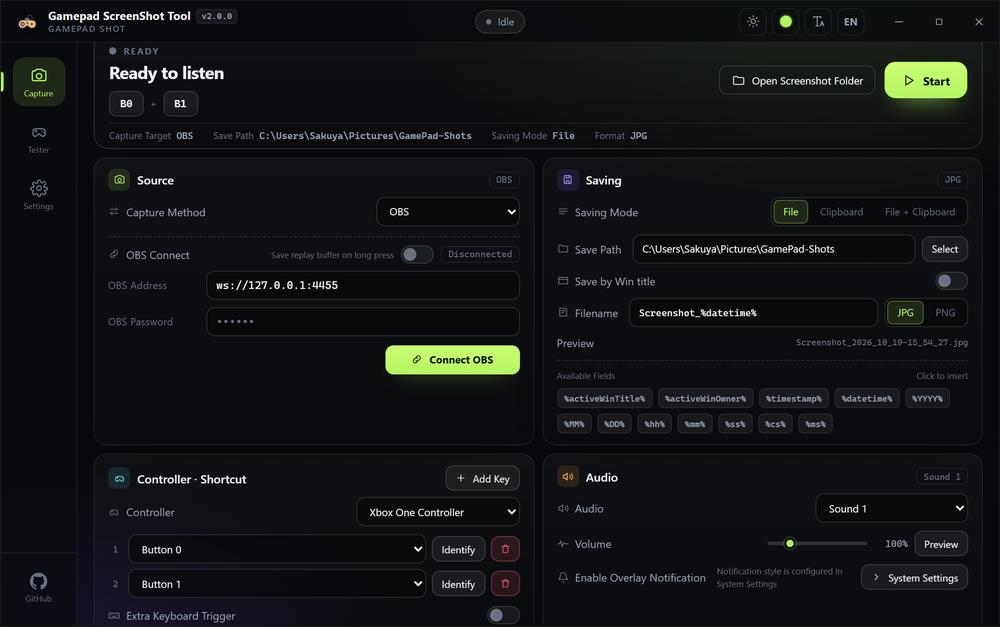

# 🎮 GamePad-ScreenShot

  <a href="../README.md">简体中文</a> | <a href="README_ZH-TW.md">繁體中文</a> | <a href="README_EN.md">English</a> | <a href="README_JA.md">日本語</a> | <a href="README_KO.md">한국어</a> | <a href="README_DE.md">Deutsch</a> | <a href="README_FR.md">Français</a> | <a href="README_ES.md">Español</a> | <a href="README_RU.md">Русский</a>

  

  <strong>Take full-screen, window or OBS screenshots with your gamepad</strong>

  
  
  

---

## 📖 Introduction

A Windows utility that lets you trigger screenshots with **gamepad button combinations** or **axis values** instead of the keyboard — perfect for games that capture the mouse or run in full screen. Screenshots can be saved to disk or the clipboard, and you can also connect to **OBS via WebSocket** to capture any OBS scene. It also supports **mapping gamepad buttons to keyboard keys or combos**, turning the controller into a shortcut pad.

- ✅ Trigger via button combinations / axis values (D-pad, L2 / R2, …)
- ✅ Extra keyboard hotkey trigger
- ✅ Full-screen capture (specific monitor selectable) or single-window capture
- ✅ Save to file, clipboard, or both — JPG / PNG
- ✅ Custom filename templates: `%activeWinTitle%`, `%timestamp%`, `%datetime%` …
- ✅ Filename conflict handling: overwrite / append timestamp / skip / ask every time
- ✅ Screenshot sound effects — 5 built-in sounds, volume control
- ✅ Overlay notification with configurable position, duration and size
- ✅ **OBS-WebSocket** integration — capture any OBS scene
- ✅ Long-press the shortcut to save the **OBS replay buffer** as a clip
- ✅ Built-in gamepad tester — buttons, axes and D-pad light up in real time
- ✅ 9 interface languages, dark / light themes, 6 accent colors
- ✅ **Gamepad buttons → keyboard keys** — a single button or a combo sends any key / key combo, including Win and media keys
- ✅ Three trigger modes: Press / Hold / Repeat, with adjustable threshold and interval; each rule can be toggled on its own
- ✅ Keys are added one at a time, so recording never fires system shortcuts
- ✅ Auto start on boot, silent startup, close to tray, start capture listener / button mapping on launch
- ✅ In-app updates

---

## 🖼️ Interface

### Main window

  

### Button Mapping

  

### Light theme

  

### Overlay notification

  

### Gamepad Tester

  

### System Settings

  

---

## 🎮 Setting Up Button Combinations

> **Note:** Axis values (D-pad directions, L2 / R2 triggers, …) can also be used as triggers. An axis counts as "pressed" only beyond **±0.85**.

1. Add keys in the **Controller · Shortcut** card. You can verify which physical button each entry corresponds to on the built-in **Gamepad Tester** page — press a button and it lights up in real time.

  

> **Tip:** Some controllers report different button indices over Bluetooth — prefer a **USB** connection while configuring shortcuts.

---

## ⌨️ Mapping Gamepad Buttons to the Keyboard

Great for actions that only exist on the keyboard — switching tracks, push-to-talk, hotbar slots — now triggered from the controller.

1. Open the **Mapping** page and click **Start** in the top-right corner (to have it run on launch, turn on **Settings → Start button mapping on launch**).
2. Click **New mapping**, hit **Detect** on the gamepad side and press a button — hold several at once to make a combo.
3. On the keyboard side click **Add key** and press the keys one by one (add modifiers first: Ctrl / Shift / Alt / Win). Click the × on a key to remove it.
4. Choose the trigger for each row: **Press** / **Hold** (threshold under Hold threshold) / **Repeat** (interval under Repeat interval).
5. Turn on **Log** in *Recent triggers* to see hits in real time.

> **Note:** mapping only sends keystrokes — it does not block the controller's original input, the game still receives it. Blocking that requires a virtual gamepad driver (e.g. ViGEm / HidHide).

---

## ⚙️ Capturing via OBS

1. Enable the **WebSocket Server** in OBS manually (usually under the "Tools" menu).
2. Open the **ScreenShot** page and switch **Capture Method** to **OBS** — the OBS connection panel expands right below.

  

3. Enter the OBS server **address** (`ws://IP:Port`) and **password**.
4. Click **Connect OBS**.
5. Once connected, select the **scene** you want to capture from the dropdown.
6. Hold the shortcut to capture the scene. With "Save replay buffer on long press" enabled, a **long-press** saves the OBS replay buffer as a clip.

---

## 📄 License

Released under the [GNU GPL v3](../LICENSE) license.
